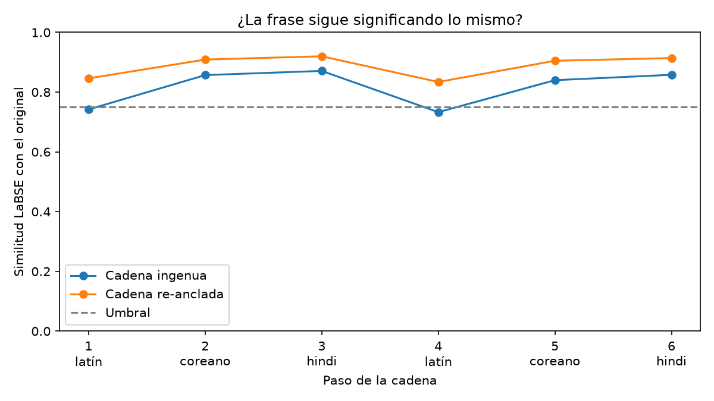

# Traductor en cadena: español → latín / coreano / hindi

Se escribe una frase en español y se traduce **en cadena**: el español pasa a
uno de los tres idiomas, esa salida pasa a otro, esa salida a otro, y así.
La condición es que **la salida siempre siga significando lo mismo** que la
frase original.

```
español → latín → coreano → hindi → latín → coreano → hindi
```

## Idea general

### 1. Traducción con un Transformer: TranslateGemma

Se usa **TranslateGemma 4B** ([`google/translategemma-4b-it`](https://huggingface.co/google/translategemma-4b-it),
Google, enero 2026), un **Transformer de solo decoder** basado en Gemma 3
(4,300 millones de parámetros) y afinado exclusivamente para traducir entre
55 idiomas principales y cientos más, latín incluido.

- Recibe una instrucción con el idioma de origen y de destino más el texto
  ("You are a professional Spanish (es) to Latin (la) translator... ").
- Genera la traducción **token por token**. En cada token, la
  **auto-atención** con varias cabezas "mira" toda la frase de entrada y lo
  que ya lleva traducido, para decidir la siguiente palabra.
- Con **beam search** se generan varias traducciones candidatas a la vez
  (las 4 secuencias más probables), no solo una.

**¿Por qué este modelo?** El latín es el idioma difícil:

| Modelo | ¿Latín? | Resultado |
|---|---|---|
| NLLB-200 (Meta), M2M-100 | No lo traen | descartados |
| Helsinki-NLP opus-mt | No hay pares es→la ni es→hi | descartados |
| MADLAD-400 3B (Google) | Sí, en papel | inventaba frases: *"Los soldados defendieron la puerta de la ciudad"* → *"Incolae Portuenses appellantur"* ("sus habitantes se llaman portuenses") |
| **TranslateGemma 4B** | **Sí** | *"Milites portas urbis defenderunt"* ✔ |

Con un solo modelo para los 4 idiomas, cada salida pasa directo al siguiente
idioma sin pivotear por inglés. Se usa la copia
[`Infomaniak-AI/vllm-translategemma-4b-it`](https://huggingface.co/Infomaniak-AI/vllm-translategemma-4b-it)
(mismos pesos, sin tener que pedir acceso en Hugging Face).

### 2. Verificar que el significado no cambie: LaBSE

El problema de encadenar traducciones es el **teléfono descompuesto**: si un
paso pierde un matiz, el siguiente traduce algo que ya no es lo original, y el
error se acumula.

Para medirlo se usa [`sentence-transformers/LaBSE`](https://huggingface.co/sentence-transformers/LaBSE),
un **Transformer tipo BERT** (solo encoder) que convierte una frase de
cualquiera de 109 idiomas, latín incluido, en un vector de 768 números. Las
frases que significan lo mismo quedan cerca aunque estén en idiomas distintos,
así que la **similitud coseno** entre la frase original en español y cada
salida dice qué tanto se conservó el significado (1 = idéntico).

### 3. Re-anclaje en cada paso

En cada paso de la cadena (`cadena.py`):

1. TranslateGemma genera **4 traducciones candidatas** de la salida anterior (beam search).
2. LaBSE compara cada candidata con la frase **original en español**, no solo
   con la del paso anterior, y se elige la más parecida. Así cada paso se
   re-ancla al significado original y el error no se acumula.
3. **Ida y vuelta**: LaBSE casi no distingue matices de registro ("quiero" vs
   "quisiera" / "me gustaría" son la misma idea para él), y en coreano el
   modelo tiende a la forma cortés (`싶어요`), que regresa como "me gustaría".
   Por eso cada candidata también se traduce de vuelta al español y su
   puntaje es `LaBSE + 0.5 × chrF(regreso, original) / 100`
   (`PESO_IDA_Y_VUELTA`): gana la que significa lo mismo **y** regresa con las
   mismas palabras (`싶다` → "quiero"). El umbral sigue usando solo LaBSE.
4. Si aun así la mejor queda debajo del umbral (`UMBRAL_SIMILITUD = 0.75`),
   también se traduce desde el español original y se elige la mejor de todas;
   el paso se marca como **corregido** en la salida.

Cada salida además se traduce de vuelta al español, para que se pueda leer
qué dice.

### 4. Datos de OPUS: afinar el latín y medir

[OPUS](https://opus.nlpl.eu) no tiene modelos: es una colección de **corpus
paralelos** (la misma frase en dos idiomas, alineada). Para nuestros pares:

| Par | Pares en OPUS | Qué se usa (`opus.py`) |
|---|---|---|
| español–latín | ~732 mil | **Tatoeba** (frases cortas traducidas por personas): 300 para prueba, el resto para entrenar. **WikiMatrix** (alineado automático de Wikipedia) filtrado: solo pares con similitud LaBSE ≥ 0.80 y las mismas cifras → 7,038 pares de entrenamiento |
| español–coreano | ~51 millones | **TED2020**: 200 frases de prueba (filtradas con LaBSE para quitar referencias rotas) |
| español–hindi | ~30 millones | **TED2020**: 200 frases de prueba (Tatoeba solo tiene 34) |

Ninguna frase de prueba (ni sus otras traducciones) aparece en el entrenamiento.

**Fine-tuning con LoRA** (`afinar_latin.py`): el latín es el idioma más débil,
así que se afina TranslateGemma con los pares de OPUS. LoRA congela los 4,300
millones de parámetros y entrena solo dos matrices pequeñas junto a cada
proyección de atención (q, k, v, o): `W' = W + B·A·(α/r)`, con r = 16 (~0.3 %
de los parámetros), con los primeros 1,500 pares (para que quepa en ~80 min de una T4). Se entrena en las dos direcciones (es→la, la→es) con
entropía cruzada solo sobre los tokens de la traducción. El adaptador se
activa únicamente en los pasos con latín; coreano e hindi usan el modelo
original.

**Evaluación con OPUS** (`evaluar_opus.py`): se traducen las frases de prueba
en las dos direcciones y se comparan contra la traducción humana con **BLEU**
(coincidencia de secuencias de 1-4 palabras) y **chrF++** (coincidencia de
caracteres y palabras, más justa con el latín, el coreano y el hindi). En
latín se compara el modelo base contra el afinado.

## Archivos

| Archivo | Descripción |
|---|---|
| `config.py` | Modelos, idiomas, orden de la cadena, número de candidatos y umbral. |
| `modelos.py` | Carga TranslateGemma (traductor) y LaBSE (verificador de significado). |
| `cadena.py` | La traducción en cadena con re-anclaje y corrección. |
| `opus.py` | Descarga los corpus de OPUS y arma los conjuntos de prueba y de entrenamiento. |
| `afinar_latin.py` | Fine-tuning del latín con LoRA (necesita GPU). |
| `evaluar_opus.py` | BLEU / chrF++ contra las traducciones humanas de OPUS. |
| `evaluar.py` | Compara la cadena ingenua contra la re-anclada sobre `frases_prueba.txt`. |
| `datos_opus/` | Conjuntos de prueba y entrenamiento ya preparados (TSV). |
| `Traductor.py` | Punto de entrada único (`traducir` / `interactivo` / `interfaz` / `evaluar`). |
| `interfaz.py` | Interfaz web con Gradio: frase, cadena, parámetros, tabla paso a paso y gráfica. |
| `frases_prueba.txt` | 20 frases en español para la evaluación. |
| `colab/Traductor_Colab.ipynb` | Notebook para Colab con GPU; trae todo el código adentro. |
| `salidas/` | Resultados de la evaluación (CSV y gráfica). |

## Cómo ejecutar (Google Colab, recomendado)

1. Abrir el notebook directo desde GitHub:
   **https://colab.research.google.com/github/AndreaHortaHernandez/Traductormultilingue/blob/main/colab/Traductor_Colab.ipynb**
2. **Entorno de ejecución → Cambiar tipo de entorno de ejecución → GPU (T4)**.
3. **Entorno de ejecución → Ejecutar todas**. El notebook clona este repo,
   instala las librerías, afina el latín, traduce una frase de ejemplo y corre
   las dos evaluaciones. En total ~2.5-3 h en una T4 gratuita (el fine-tuning es ~80 min).
4. Quien entrene el adaptador de latín lo sube al repo con la sección 11
   (junto con las métricas de `salidas/`). Desde ahí, a los demás el notebook
   se lo trae al clonar y **se salta el entrenamiento**.
5. En la sección 7 se cambia la frase y el orden de idiomas para probar otras.
6. La sección 10 abre la **interfaz web** (abajo en la celda y con un enlace público
   `*.gradio.live`). Si solo quieres la interfaz, desmarca las casillas de las
   evaluaciones (secciones 8 y 9) antes de *Ejecutar todas*: queda lista en ~10 min.

Para guardar cambios al notebook en el repo: **Archivo → Guardar una copia en GitHub**.

## Cómo ejecutar (local)

```powershell
python -m pip install -r requirements.txt

python Traductor.py traducir "El perro duerme bajo la mesa."
python Traductor.py traducir "El perro duerme bajo la mesa." --cadena hi la ko la
python Traductor.py interactivo
python Traductor.py interfaz               # http://127.0.0.1:7860
python Traductor.py interfaz --compartir   # además, un enlace público temporal
python Traductor.py evaluar              # tarda: 20 frases x 2 modos
python Traductor.py evaluar --limite 5   # versión rápida
```

La primera vez se descargan los modelos (~8.6 GB TranslateGemma + ~2 GB
LaBSE) a la caché de Hugging Face. Corre en CPU en float32 (necesita ~20 GB
de RAM libre; ~20 s por paso, ~4 min una cadena de 6 pasos); con GPU es mucho
más rápido.

## Interfaz web

`interfaz.py` (Gradio) recibe la frase y los idiomas a los que se traduce: se
eligen con botones (**+ latín**, **+ coreano**, **+ hindi**) en el orden que se
quiera, y con uno solo se traduce directo a ese idioma. Hay atajos para la
cadena completa o una vuelta, y también se puede escribir como códigos o
nombres, con o sin acento (`la ko hi`, `latín → coreano`). Muestra cada paso con su traducción,
su regreso al español, la similitud LaBSE y si se corrigió, además de una gráfica
de la similitud por paso. En **Parámetros** se cambian los candidatos, el peso de
ida y vuelta y el umbral solo para esa consulta, sin tocar `config.py`. También se
puede comparar contra la cadena ingenua.

**Acentos:** todo el texto es Unicode y los modelos lo reciben en UTF-8, así que
los acentos, la ñ y ¿¡ funcionan igual que cualquier otra letra. La frase se
normaliza a NFC (`cadena.py`), porque un acento "descompuesto" (e + ´, común al
pegar desde PDFs o Mac) se ve igual pero son otros caracteres, y el chrF de ida y
vuelta lo contaría como diferencia. En la consola de Windows, `Traductor.py`
fuerza la salida a UTF-8 para poder imprimir coreano e hindi.

## Evaluación

`evaluar.py` corre la cadena de 6 pasos sobre las 20 frases de dos formas:

- **Ingenua**: cada paso solo traduce la salida anterior con la traducción
  más probable, sin verificar.
- **Re-anclada**: la del proyecto.

Y reporta por paso: similitud LaBSE media y mínima con el original, % de
salidas arriba del umbral, **chrF** de la traducción de vuelta al español
contra la original (métrica de traducción automática independiente de LaBSE)
y % de pasos corregidos.

**Ojo:** con la ida y vuelta (paso 3 de la cadena re-anclada) el chrF de
regreso también se usa para *elegir* candidatas, así que en la cadena
re-anclada ya no es una métrica independiente: su mejora se debe en parte a
que se optimiza directamente. Por eso abajo se reporta junto a la similitud
LaBSE, que sí sigue siendo independiente, y contra la corrida anterior sin ida y
vuelta (`PESO_IDA_Y_VUELTA = 0`).

## Resultados (Colab, GPU T4)

### Fine-tuning del latín con OPUS

LoRA con 1,500 pares (3,000 ejemplos, 375 pasos, ~80 min). La pérdida bajó de
1.89 a ~1.24 (`adaptador_latin/estado.json`).

Contra las traducciones humanas de prueba (`salidas/metricas_opus.csv`):

| Dirección | Frases | BLEU base | BLEU afinado | chrF++ base | chrF++ afinado |
|---|---|---|---|---|---|
| español → latín | 300 (Tatoeba) | 16.0 | **24.5** | 36.7 | **42.7** |
| latín → español | 300 (Tatoeba) | 30.8 | **37.3** | 50.3 | **54.9** |
| español → coreano | 200 (TED2020) | 13.8 | — | 24.7 | — |
| coreano → español | 200 (TED2020) | 18.7 | — | 43.5 | — |
| español → hindi | 200 (TED2020) | 21.0 | — | 41.2 | — |
| hindi → español | 200 (TED2020) | 24.2 | — | 48.7 | — |

El fine-tuning sube el latín unos 6.5-8.5 puntos de BLEU y 4.5-6 de chrF++ en las
dos direcciones. Una segunda corrida en Colab dio lo mismo con diferencias de
±0.5 (versiones de las librerías). **Ojo al interpretarlo**: las frases de prueba son de Tatoeba,
igual que buena parte del entrenamiento, así que parte de la mejora es que el
modelo aprendió el estilo de Tatoeba (orden de palabras, nombres latinizados
como *Thoma*), no solo mejor latín; en algunas frases el afinado comete
errores que el base no (`salidas/traducciones_opus.csv`). Coreano e hindi se
miden con TED2020 (charlas, frases más largas y libres), por eso sus números
no son comparables con los del latín.

### Cadena de 6 pasos: ingenua vs re-anclada

20 frases, cadena latín → coreano → hindi → latín → coreano → hindi
(`salidas/resumen_por_paso.csv`, `salidas/similitud_por_paso.png`). La
re-anclada es la actual, con ida y vuelta (`PESO_IDA_Y_VUELTA = 0.5`):

| Paso | Idioma | Similitud ingenua | Similitud re-anclada | % arriba del umbral (ingenua → re-anclada) |
|---|---|---|---|---|
| 1 | latín | 0.742 | **0.846** | 55 % → **90 %** |
| 2 | coreano | 0.857 | **0.909** | 85 % → **100 %** |
| 3 | hindi | 0.871 | **0.920** | 90 % → **100 %** |
| 4 | latín | 0.733 | **0.834** | 50 % → **90 %** |
| 5 | coreano | 0.840 | **0.905** | 85 % → **100 %** |
| 6 | hindi | 0.858 | **0.914** | 90 % → **100 %** |

Con la cadena ingenua el significado se va perdiendo y el latín es el punto
débil (la mitad de las frases queda por debajo del umbral). Con el re-anclaje
la similitud se mantiene estable en los 6 pasos, sin acumular error: la frase
final en hindi conserva el significado tanto como la del paso 2. La corrección
desde el original solo hizo falta en el 5 % de los pasos 2, 4 y 5.

Ejemplo: *"El perro duerme bajo la mesa."* →
*Canis sub mensam dormit.* → 개는 탁자 아래에서 잠을 자고 있습니다. → कुत्ता मेज के
नीचे सो रहा है। → *Cane sub mensa dormit.* → …, y cada paso regresa como *"El
perro duerme / está durmiendo debajo de la mesa"* (similitud 0.90-0.96).



### Efecto de la ida y vuelta

Re-anclada sin ida y vuelta (corrida anterior,
`salidas/resumen_por_paso_sin_ida_y_vuelta.csv`) contra con ida y vuelta:

| Paso | Idioma | Similitud LaBSE (sin → con) | % arriba del umbral | chrF del regreso (sin → con) |
|---|---|---|---|---|
| 1 | latín | 0.847 → 0.846 | 90 % → 90 % | 81.2 → **84.2** |
| 2 | coreano | 0.913 → 0.909 | 100 % → 100 % | 70.6 → **74.4** |
| 3 | hindi | 0.922 → 0.920 | 100 % → 100 % | 70.8 → **74.6** |
| 4 | latín | 0.840 → 0.834 | 95 % → 90 % | 69.2 → **78.0** |
| 5 | coreano | 0.913 → 0.905 | 100 % → 100 % | 65.8 → **74.4** |
| 6 | hindi | 0.919 → 0.914 | 100 % → 100 % | 70.0 → **73.7** |

Las traducciones elegidas regresan al español con palabras más parecidas a la
original (+3 a +9 de chrF, sobre todo en el segundo latín y el segundo
coreano), a cambio de una similitud LaBSE apenas menor (≤ 0.008) y una frase
menos arriba del umbral en el paso 4. Como el chrF del regreso se usa para
elegir, esa subida está optimizada directamente y no es una mejora
independiente; la conclusión justa es que se conserva el significado (LaBSE
casi igual) y se gana fidelidad en las palabras. El costo es tiempo: en la T4
la cadena re-anclada tarda ~38 s por frase (la ingenua ~14 s), porque cada
candidata también se traduce de vuelta.

> Los resúmenes (`resumen_por_paso.csv`, `metricas_opus.csv`) y la gráfica son de
> esta corrida. Los CSV frase por frase (`resultados_cadena.csv`,
> `traducciones_opus.csv`) siguen siendo de la corrida anterior, porque los de
> esta no se subieron desde Colab.

## Créditos de los datos

Corpus descargados de [OPUS](https://opus.nlpl.eu) (J. Tiedemann, *Parallel Data,
Tools and Interfaces in OPUS*, LREC 2012): **Tatoeba** (tatoeba.org, CC BY 2.0 FR),
**WikiMatrix** (Schwenk et al., 2019, CC BY-SA) y **TED2020** (Reimers y Gurevych,
2020, CC BY-NC-ND 4.0). Los conjuntos de `datos_opus/` son subconjuntos filtrados
de estos corpus y conservan sus licencias.
